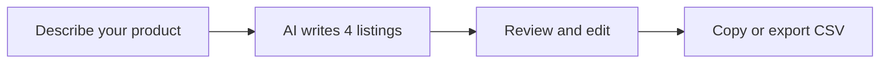

<div align="center">

# QuickList AI

**Write your product once. Get optimized listings for Amazon, Etsy, Shopify and eBay.**

[**Try the live demo**](https://boudydegeer.github.io/quicklist-ai/) · [Compare](https://boudydegeer.github.io/quicklist-ai/compare) · [Report a bug](../../issues)

[](https://nextjs.org/)
[](https://react.dev/)
[](https://www.typescriptlang.org/)
[](https://tailwindcss.com/)
[](https://supabase.com/)

<!-- Add a screenshot or GIF of the generator here:

-->

</div>

---

## Why QuickList AI

Every marketplace wants a different listing. Writing the same product four ways takes hours. QuickList AI turns one product description into four tailored listings, with SEO metadata included, in about 30 seconds. No sign-up needed to try it.

## Features

| | |
|---|---|
| **4 marketplaces, 1 click** | Amazon, Etsy, Shopify and eBay listings generated together |
| **Marketplace-specific SEO** | Written for Amazon A9, Etsy search, Shopify and eBay Cassini |
| **Complete listing content** | Titles, descriptions, bullet points, tags and keywords |
| **SEO metadata** | Meta titles, meta descriptions and image alt text |
| **Bring your own key** | Use your own Gemini API key (10 generations a day), stored locally in your browser |
| **CSV export** | Download every listing for bulk upload to your seller accounts |
| **Responsive** | Works on desktop, tablet and mobile |

## How it works



1. **Describe your product.** Enter the name, category and key features.
2. **Generate.** QuickList AI writes optimized content for all four marketplaces.
3. **Review and export.** Edit if needed, then copy each field or download a CSV.

## Tech stack

| Layer | Technology |
|---|---|
| Framework | Next.js 16 (App Router), React 19 |
| Language | TypeScript 5 |
| Styling | Tailwind CSS 4 |
| Database and auth | Supabase (PostgreSQL) |
| AI | Google Gemini 2.5 Flash |
| Payments | Stripe |

## Getting started

```bash
# Install dependencies
npm install

# Start the dev server at http://localhost:3000
npm run dev

# Build for production
npm run build
```

## Compare

See how QuickList AI stacks up against manual listing creation and other tools: [**View the comparison**](https://boudydegeer.github.io/quicklist-ai/compare).

## License

Copyright © 2026 Project X. All rights reserved.
